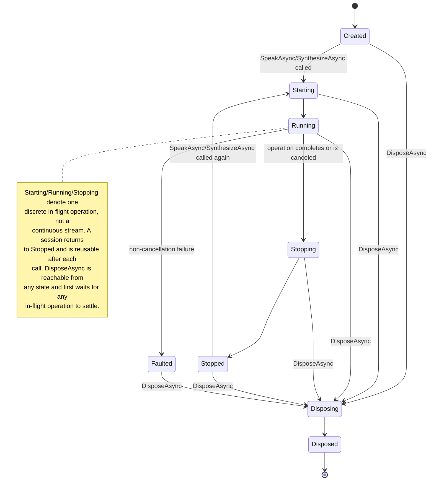

## SynthesisSubsystem Design

### Overview

The SynthesisSubsystem provides text-to-speech capability. Its Layer 1 concern is the closed,
fixed Natural Language Audio Tag vocabulary and the model-independent parser; its Layer 2 concern
is per-model rendering of a parsed span sequence into a `SpeechPlan`. Its public text-to-speech
API is an explicit, 5-layer async Engine/Session vocabulary that mirrors the
RecognitionSubsystem's own Engine/Session API: `ISpeechSynthesizerEngine` (Layer 3 - the public,
loaded, expensive, native-backed model, obtained once) creates cheap, reusable
`ISynthesisSession` instances (Layer 5 - one per bound playback device), each with its own
explicit `SynthesisSessionState` lifecycle, so a host does not have to reconstruct a synthesizer
per utterance. The native seam is `ISynthesisBackend`/`ISynthesisBackendFactory`, leaving the
word "engine" for the public Layer 3 contract. `ISynthesisBackend` is public and
`ISynthesisBackendFactory` is internal. It contains the following direct units:

- **AudioTagParser**: the pure, model-independent scanner, together with the **AudioTagCatalog**
  alias/kind lookup table it consumes and the **NaturalLanguageAudioTag** /
  **NaturalLanguageAudioTagKind** / **TaggedTextSpan** / **TaggedTextSpanKind** value types it
  operates over
- **IModelCapabilityProfile** and **DefaultModelCapabilityProfile**: the Layer 2 rendering
  strategy that turns a parsed span sequence into an ordered **SpeechPlan** of **SpeechSegment**s,
  deciding per tag whether to pass it through, approximate it, or strip it, driven purely by the
  selected model's own declared audio-tag support and parameters
- **SentenceChunker**: splits synthesis-ready plain text into sentence/clause-sized chunks so
  chunked synthesis has natural-sounding boundaries
- **ISpeechSynthesizerEngine**: the public Layer 3 contract for a loaded synthesis model -
  availability, `CreateSessionAsync`, and one-shot `SpeakAsync`/`SynthesizeAsync` convenience
  overloads - together with the **SynthesizedSpeech** value type it and `ISynthesisSession` yield
- **ISynthesisSession**: the public Layer 5 contract for one session bound to one playback
  device - availability, a `SynthesisSessionState` lifecycle with a `StateChanged` event,
  non-overlapping `SpeakAsync`/`SynthesizeAsync` operations, and `StopAsync`
- **SpeechSynthesizerFactory**: composition root that asynchronously loads a real engine or
  returns the honest unavailable fallback, and never throws for an ordinary machine state
- **SpeechSynthesizerEngine**: the real `ISpeechSynthesizerEngine` implementation,
  owning one loaded synthesis backend (the public
  **ISynthesisBackend** seam, loaded through the internal
  **ISynthesisBackendFactory** seam and its model-driven
  **DefaultSynthesisBackendFactory** implementation, which asks the model itself to construct its
  backend via `ISynthesisModel.CreateBackend`) and enforcing single-session exclusivity via a
  fail-fast lease. The real sherpa-onnx `ISynthesisBackend` implementation,
  `SherpaOnnxSynthesisEngine`, is not part of this subsystem: it lives in the sibling `SpeechSherpa`
  system - see _SpeechSherpa SynthesisSubsystem Design_
- **SynthesisSession**: the real `ISynthesisSession` implementation, together with the
  **PlaybackAudioResampler** that converts synthesized audio into the format a playback device
  requires
- **SynthesisSessionState** and **SessionStateChangedEventArgs**: the session lifecycle state
  enum and its `StateChanged` event-argument type
- **SynthesisEngineBusyException** and **SynthesisSessionFaultedException**: exceptions signaling
  a lease conflict and a terminal session fault respectively
- **DedicatedWorker**: internal utility applying a cooperative-cancel-then-abandon policy to a
  non-cooperative native synthesis call; a separate, synthesis-specific implementation from
  the RecognitionSubsystem's utility (see its own document for how the two differ)
- **UnavailableSpeechSynthesizerEngine**, **UnavailableSynthesisSession**, and
  **SpeechSynthesizerUnavailableException**: honest fallback behavior when no model, no engine
  backend, or no playback device is available

### Interfaces

The subsystem exposes `NaturalLanguageAudioTag`, `NaturalLanguageAudioTagKind`,
`AudioTagDescriptor`, `AudioTagCatalog`, `TaggedTextSpanKind`, `TaggedTextSpan`, `AudioTagParser`,
`ISpeechSynthesizerEngine`, `ISynthesisSession`, `ISynthesisBackend`, `BackendAudio`,
`IModelCapabilityProfile`, `SpeechPlan`, `SpeechSegment`, `SynthesizedSpeech`,
`SynthesisSessionState`, `SessionStateChangedEventArgs`, `SpeechSynthesizerFactory`,
`UnavailableSpeechSynthesizerEngine`, `UnavailableSynthesisSession`,
`SynthesisEngineBusyException`, `SynthesisSessionFaultedException`, and
`SpeechSynthesizerUnavailableException` as its public API. It consumes `IAudioPlaybackDevice` from
the AudioSubsystem for output audio, `ISynthesisModel` from the ModelManagementSubsystem for
backend construction (`CreateBackend`), the preferred playback-format hint, and the Layer 2
rendering strategy, and
`ISpeechDiagnostics` from the Diagnostics subsystem to report structural composition, lifecycle,
and fault facts without ever exposing synthesized text.

No member of the subsystem's public API names a sherpa-onnx type, per this library's
"engine backend stays swappable at the public API surface" decision. No member of the subsystem -
public or internal - names a sherpa-onnx type at all: `ISynthesisModel`'s public `CreateBackend`
member returns the engine-neutral, equally public `ISynthesisBackend` seam, and every concrete
engine backend lives in a model-supplying extension such as the sibling `SpeechSherpa` system (or,
by design, in any third-party package implementing `ISynthesisModel`).

### Design

This document describes only what is shared across the subsystem's units; each unit's data model, methods,
error handling, and rationale are in its own document under `synthesis-subsystem/`.

#### Pipeline

Text flows through four stages, each owned by one unit:

1. **Layer 1 - parsing**: _AudioTagParser_ turns bracketed text
   into an ordered span list, via the `AudioTagCatalog` alias table. It never throws and never drops
   input: anything that is not a recognized tag stays plain text ("never worse than plain narration").
2. **Layer 2 - rendering**: _Layer 2 rendering_
   (`IModelCapabilityProfile` / `DefaultModelCapabilityProfile`) turns the spans into a `SpeechPlan`
   according to the selected model's declared tag support; pause tags always render as real silence.
   Narration between tags is split by _SentenceChunker_.
3. **Synthesis**: _SynthesisSession_ synthesizes each segment in
   turn through the _ISynthesisBackend_ seam (see _SynthesisBackend_), running each native
   call on a _DedicatedWorker_.
4. **Playback**: for `SpeakAsync` only, each segment is converted by _PlaybackAudioResampler_ and written to the bound
   playback device and the next segment is then synthesized. Synthesis never runs ahead of the
   segments already handed to the device (no synthesis queue), but the device plays already-written
   audio concurrently, so playback of the first segment begins while later segments are still being
   synthesized.

#### Layer 3/Layer 5 Vocabulary: Engine, Session, and the Lifecycle State Machine

An `ISpeechSynthesizerEngine` represents one loaded synthesis model - expensive to obtain, cheap to keep
for a program's whole life. `CreateSessionAsync(device, cancellationToken)` binds it to one
`IAudioPlaybackDevice` and returns an `ISynthesisSession` that is reusable across many calls, so a host
holds one session per device rather than one short-lived synthesizer per utterance. At most one session
may be leased from an engine at a time; a second `CreateSessionAsync` fails immediately with
`SynthesisEngineBusyException` instead of queueing (see _SpeechSynthesizerEngine_).

Each session exposes an explicit `SynthesisSessionState` lifecycle. `Starting`/`Running`/`Stopping` denote
one discrete in-flight operation, not a continuous stream: a session returns to `Stopped` after each
operation and is immediately ready for another.

Operations on one session never overlap (a second call while an operation is in flight throws
`InvalidOperationException`), and a non-cancellation failure - including a canceled operation whose
native call had to be abandoned - makes the session terminally `Faulted`, directly from `Running`
(the only state a fault can occur in). The
transition rules, the stop and dispose behavior, and the fault handling are specified in _SynthesisSession_.

#### Units

The session coordinates several units, each documented in its own file under
`synthesis-subsystem/`. The session's whole job is to move text through rendering and chunking,
into the backend (via a dedicated worker), and the resulting audio through resampling onto its
bound playback device. Internal helpers (`SpeechParameterConventions`, `SentenceChunk`, and
`DedicatedWorkerRun<T>`) are documented with the unit that owns them (Layer 2 rendering,
_SentenceChunker_, and _DedicatedWorker_ respectively).

| Unit | Design document |
| ---- | --------------- |
| `AudioTagParser` (with `AudioTagCatalog` and the tag value types) | `synthesis-subsystem/audio-tag-parser.md` |
| `IModelCapabilityProfile`, `DefaultModelCapabilityProfile` | `synthesis-subsystem/layer2-rendering.md` |
| `SentenceChunker` | `synthesis-subsystem/sentence-chunker.md` |
| `ISynthesisBackend`, `ISynthesisBackendFactory` | `synthesis-subsystem/synthesis-backend.md` |
| `DefaultSynthesisBackendFactory` | `synthesis-subsystem/synthesis-backend.md` |
| `DedicatedWorker` | `synthesis-subsystem/dedicated-worker.md` |
| `PlaybackAudioResampler` | `synthesis-subsystem/playback-audio-resampler.md` |
| `SpeechSynthesizerEngine` | `synthesis-subsystem/speech-synthesizer-engine.md` |
| `SynthesisSession` | `synthesis-subsystem/synthesis-session.md` |
| `ISpeechSynthesizerEngine` | `synthesis-subsystem/i-speech-synthesizer-engine.md` |
| `ISynthesisSession` | `synthesis-subsystem/i-synthesis-session.md` |
| `SpeechSynthesizerFactory` | `synthesis-subsystem/speech-synthesizer-factory.md` |
| `UnavailableSpeechSynthesizerEngine` | `synthesis-subsystem/unavailable-speech-synthesizer-engine.md` |
| `UnavailableSynthesisSession` | `synthesis-subsystem/unavailable-synthesis-session.md` |
| `SpeechSynthesizerUnavailableException` | `synthesis-subsystem/speech-synthesizer-unavailable-exception.md` |
| `SynthesisEngineBusyException` | `synthesis-subsystem/synthesis-engine-busy-exception.md` |
| `SynthesisSessionFaultedException` | `synthesis-subsystem/synthesis-session-faulted-exception.md` |

#### Design Constraints

**Volume and speed are applied by the session, not by tag rendering alone.** The backend seam has
no volume input, so volume overrides are applied as post-hoc amplitude scaling, while speed
overrides are passed to the backend; the exact mechanics are specified in _SynthesisSession_.

**Voice/speaker selection is a session-level concern, not a per-segment override.** The speaker
is resolved by the model from the session's selected parameter values, deliberately not through
the transient, tag-scoped per-segment overrides. The exact resolution mechanics are specified in
_SynthesisSession_.

**Mechanisms behind the subsystem's observable behavior.** The requirements state only what a
host observes; the mechanisms live here and in the unit documents. The optional parameter-value
bag passed to `SpeechSynthesizerFactory` is forwarded to the session, which asks the model to
resolve the speaker once per synthesized segment (_SpeechSynthesizerFactory_, _SynthesisSession_).
Every native call runs on a dedicated long-running thread under a cooperative-cancel-then-abandon
policy: cancellation is requested first, and a call that does not return within the abandon
timeout is detached so the caller is never hung, leaving the session `Faulted` (_DedicatedWorker_,
_SynthesisSession_). `StopAsync` cancels the in-flight operation and completes only when that
operation has unwound, and does nothing when none is in flight (_SynthesisSession_).

**Synthesized text is never reported through diagnostics.** Every diagnostic this subsystem emits
is a structural fact - composed, started, stopped, faulted, or lease-related - and never includes
synthesized text, honoring the same `ISpeechDiagnostics` contract the recognition direction
honors for recognized text.
